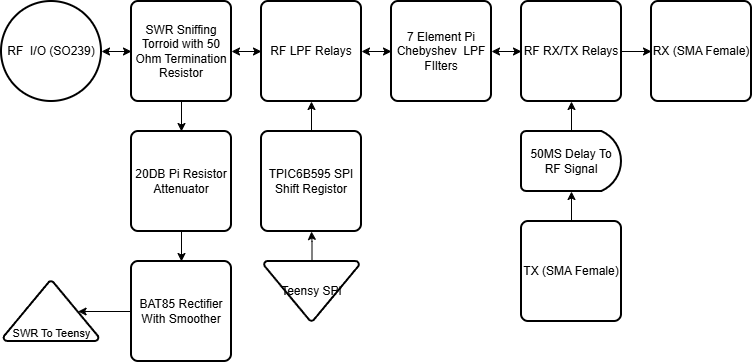
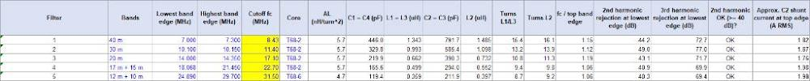
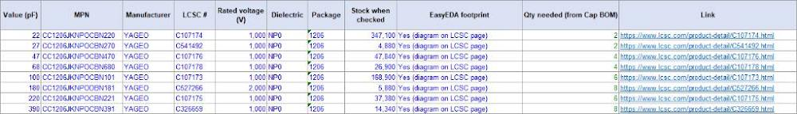
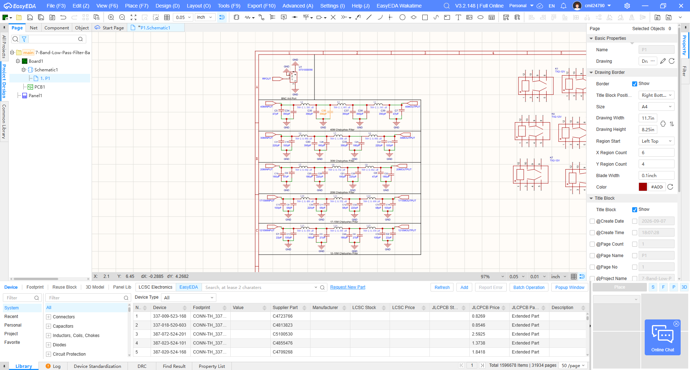

# Development Journal
## DevLog #1 9/19/26
## Hours Taken W/O Hackatime: 1
### This project needs to start somewhere and what is no better of a starting point than the LPF Bank. The first part I needed to do for the bank is to find the correct LC values for the filters. I decided that in the future, this bank will need to filter the harmonics of a Class E Amplifier and so I decided that the best filter architecture is the 7-Element Chebyshev Pi Low Pass Filter. Also I decided that the transmitter will output a maximum of 50W PEP and would require a beefier setup than a simple QRP. The chosen capacitors are 3KV C0G 1812 Package for the needed resilience to the reactive load and the inductors are T68-2 wound with 20AWG magnet wire for handling the current with relatively low insertion loss for the best efficiency. The values were derived thanks to [Chebyshev Low Pass Filter Designer](https://leleivre.com/rf_chebyshev_LPF.html) and I changed up some of the values to make sure that they can be easily found on LCSC (It doesn't need to be exact, it just needs to be FCC compliant).

## DevLog #2 10/10/26
## Hours Taken W/O Hackatime: 2
### So apparently school exists and demands a lot of my time but here I am again. I decided that I needed an organized way to make the filter and SWR meter so I made a flowchart that shows the different parts to the module and the order they go in (kinda important). Lastly, I found out that LCSC does not supply 820pF C0G SMD Capacitors for some reason and I realized that there also is not much reason to have a dedicated filter for the 40M band as the 2nd harmonic of it falls after the 11.4MHz cutoff of the other filter.

## DevLog #3 10/11/26
## Hours Taken W/O Hackatime: 2
### I hit a bit of a roadblock yesterday and found that LSCS does have the parts I need but there are mismatches in EasyEDA as sometimes there are no footprints for some of the parts. I decided to try Claude just once to help derive the Chebyshev Filter values once again and to look on LCSC to find 1206 NP0 capacitors that match the filter values THAT ARE IN STOCK AND HAVE FOOTPRINTS. Anyways, here are the updated values with the corresponding part numbers in LCSC.

### I finally got the LPF banks done and now I have to just make the relay switching with the shift register and also the SWR Meter.
