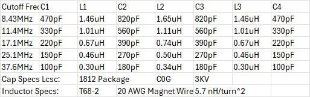

# Development Journal
## DevLog #1 9/19/26
## Hours Taken W/O Hackatime: 1
### This project needs to start somewhere and what is no better of a starting point than the LPF Bank. The first part I needed to do for the bank is to find the correct LC values for the filters. I decided that in the future, this bank will need to filter the harmonics of a Class E Amplifier and so I decided that the best filter architecture is the 7-Element Chebyshev Pi Low Pass Filter. Also I decided that the transmitter will output a maximum of 50W PEP and would require a beefier setup than a simple QRP. The chosen capacitors are 3KV C0G 1812 Package for the needed resilience to the reactive load and the inductors are T68-2 wound with 20AWG magnet wire for handling the current with relatively low insertion loss for the best efficiency. The values were derived thanks to [Chebyshev Low Pass Filter Designer](https://leleivre.com/rf_chebyshev_LPF.html) and I changed up some of the values to make sure that they can be easily found on LCSC (It doesn't need to be exact, it just needs to be FCC compliant).

